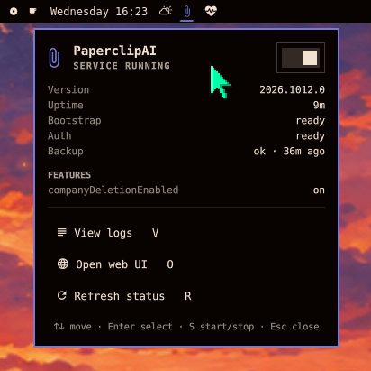

# Paperclip AI

An Omarchy bar widget for a local [PaperclipAI](https://github.com/paperclipai/paperclip)
server. A paperclip icon on the bar shows whether the service is running, and
a keyboard-driven panel starts and stops it, tails its logs, opens the web UI,
and shows live health details.

This is an unofficial community plugin. It is not affiliated with the
PaperclipAI project.



- The bar icon uses your theme's accent color while the service runs and the
  muted color when it is stopped. It follows `omarchy theme set`.
- The panel header has a switch that starts and stops the service. While
  systemd catches up, the panel shows "Starting…" or "Stopping…".
- Health details come from `/api/health`: version, uptime, bootstrap status,
  auth readiness, database backup status and age, and feature flags.
- Every control is on one keyboard cursor, so the panel works without a mouse.

## Requirements

- Omarchy with the Quickshell-based Omarchy shell.
- PaperclipAI running as a systemd **user** service. The default unit name is
  `paperclipai.service`. See [Configuration](#configuration) to use another one.
- `curl`, which Omarchy installs by default.

The plugin does not install, configure or update PaperclipAI itself.

## Install

```bash
omarchy plugin add https://github.com/lutzlstein/omarchy-paperclip --enable
```

The widget goes in the center section of the bar. Move it with
`omarchy bar move io.github.lutzlstein.paperclip --section right`.

## Uninstall

```bash
omarchy plugin remove io.github.lutzlstein.paperclip
```

This removes the plugin folder and its bar entry. PaperclipAI and its service
are not changed.

## Controls

| Action | Mouse | Keyboard (panel open) |
|--------|-------|-----------------------|
| Open or close the panel | Left-click the bar icon | Esc closes |
| Start or stop the service | Right-click the bar icon, or the header switch | S |
| View colored logs (`journalctl -f`) | Middle-click the bar icon | V |
| Open the web UI | | O |
| Refresh status | | R |
| Move between controls | Hover | Up/Down or j/k |
| Activate the selected control | Click | Enter or Space |

Open the panel from a keybinding or script with:

```bash
omarchy-shell io.github.lutzlstein.paperclip toggle
```

The IPC target also has `open`, `close`, `toggleService` and `status`.

## Configuration

Set options on the widget's entry in `~/.config/omarchy/shell.json`. The shell
reloads the file on save.

```json
{
  "id": "io.github.lutzlstein.paperclip",
  "apiUrl": "http://localhost:3100",
  "serviceUnit": "paperclipai.service"
}
```

| Key | Default | Purpose |
|-----|---------|---------|
| `apiUrl` | `http://localhost:3100` | Base URL of the PaperclipAI server. The panel reads `<apiUrl>/api/health` and opens `<apiUrl>` in the browser. |
| `serviceUnit` | `paperclipai.service` | systemd user unit to watch, start, stop and tail. |

## How it works

- Every 5 seconds the widget runs `systemctl --user is-active <serviceUnit>`.
- Start and stop run `systemctl --user start|stop <serviceUnit>`.
- While the panel is open and the service runs, it requests
  `<apiUrl>/api/health` with `curl` every 10 seconds.
- Logs open in a terminal through `omarchy-launch-tui`, following
  `journalctl --user -f -o cat -u <serviceUnit>`. When `bat` is installed (Omarchy
  ships it), lines pass through `bat -l log --theme=ansi`, so log levels,
  timestamps, routes, status codes and JSON are colored with your terminal's
  theme palette. Without `bat` the plain journal is shown.

The plugin has no other side effects. Everything runs as your own user, and
it does not write files.

## License

MIT. See [LICENSE](LICENSE).
